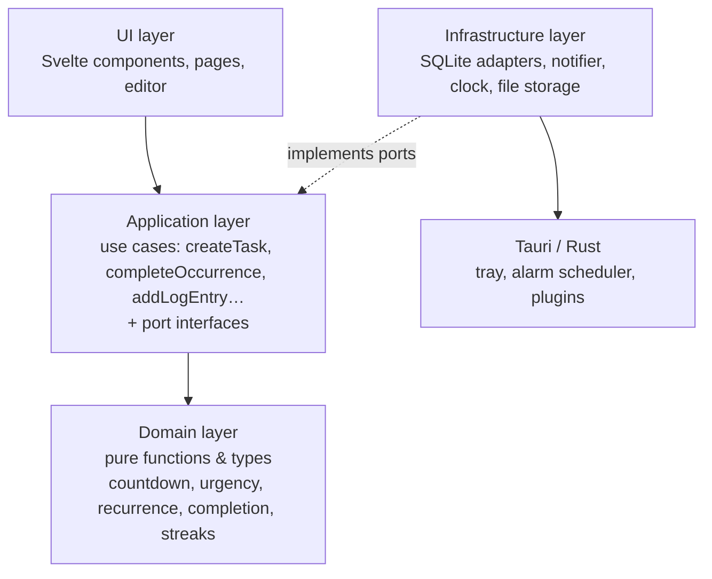
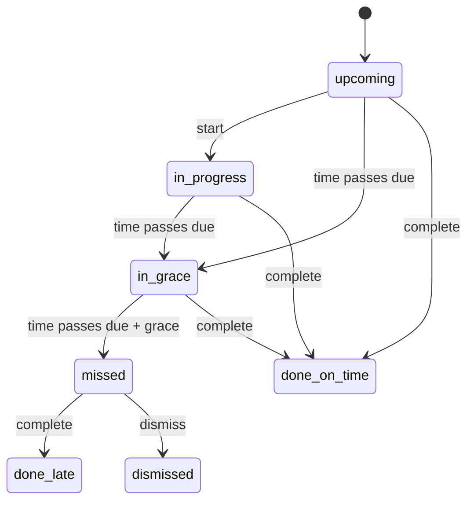

# LightNotes — Software Design Document
*Version 0.1 (draft) · 2026-11-03*

The [[SRS|SRS]] says **what** LightNotes does. This document says **how** it is built. Requirement IDs (FR-T6, NFR-1…) refer to the SRS. Choices marked **ADR** need a short decision record before you build them; see [[development-guide#3.8 Architecture Decision Records (ADRs)]].

This is a living document. When the code and this document disagree, fix one of them in the same pull request.

---

# 1. Design principles
1. **Pure core, thin edges.** All the rules (countdowns, recurrence, grace periods, streaks) live in plain TypeScript functions with no UI, database or clock inside them. They're easy to test and reason about.
2. **Store facts, derive states.** Store what happened (due time, completion time, dismissal). Work out *missed*, *late* and *urgency colour* on the fly from those facts and the current time. Derived states can then never go stale or contradict each other.
3. **Time comes from timestamps, never counters.** Every countdown is `dueAt − now` (FR-P3). Nothing breaks when the app sleeps or closes.
4. **The current time is passed in.** Core functions take `now` as an argument instead of reading the clock. Tests can then freeze time at any moment, e.g. "the night clocks change".
5. **Depend on interfaces, not implementations (ports and adapters).** The app talks to `TaskRepository`, `Notifier` and `Clock` interfaces. Each platform plugs in its own implementation (SQLite on desktop, SQLite-WASM in the browser, in-memory fakes in tests).
6. **Local first.** The device's database is the source of truth. Sync (Phase 2) is added on top and never required.

# 2. Architecture



**The dependency rule:** arrows only point inwards.
- `domain` imports nothing from the other layers.
- `app` imports `domain` only.
- `ui` and `infra` may import from `app` and `domain`.

This is enforced with an ESLint rule (`no-restricted-imports` or `eslint-plugin-boundaries`), so mistakes fail CI rather than relying on discipline.

**Startup:** `main.ts` is the one place that knows about every layer. It detects the platform (Tauri or browser), creates the matching adapters, passes them to the use cases, and mounts the UI. This is called the *composition root*.

# 3. Project structure
The code lives in its own repository, **outside the Obsidian vault** (`node_modules` would flood the vault). These documents move into `docs/` in that repo, which you can open as a second Obsidian vault.

```text
lightnotes/
├─ src/
│  ├─ domain/              # pure TS, 100 % unit tested
│  │  ├─ time.ts           # ms constants, LocalTime/LocalDate helpers
│  │  ├─ countdown.ts      # formatCountdown (FR-P4)
│  │  ├─ urgency.ts        # urgency level & window fraction (FR-T8, FR-P5)
│  │  ├─ recurrence.ts     # next due time from a rule (FR-T4)
│  │  ├─ occurrences.ts    # materialise occurrences, derive states (FR-T5–T7)
│  │  ├─ completion.ts     # grace, late, backdating rules (FR-T10–T12)
│  │  ├─ sessions.ts       # session remaining time, pause/resume (FR-D)
│  │  ├─ streaks.ts        # streaks & stats (FR-S)
│  │  ├─ tags.ts           # extract #tags from markdown (FR-N3)
│  │  └─ log.ts            # log heading format (FR-L2)
│  ├─ app/                 # use cases + ports (interfaces)
│  │  ├─ ports.ts
│  │  ├─ tasks.ts  notes.ts  sessions.ts  alarms.ts  export.ts
│  ├─ infra/
│  │  ├─ db/
│  │  │  ├─ migrations/001_init.sql …
│  │  │  ├─ db.ts                 # low-level Db interface
│  │  │  ├─ tauri-sqlite.ts       # Db via tauri-plugin-sql
│  │  │  ├─ wasm-sqlite.ts        # Db via SQLite-WASM + OPFS (browser)
│  │  │  └─ repositories.ts       # SQL repositories, written once on top of Db
│  │  ├─ notify/  tauri.ts  web.ts
│  │  ├─ files/   tauri.ts  opfs.ts   # attachment storage
│  │  └─ clock.ts
│  ├─ ui/
│  │  ├─ pages/       TimersPage.svelte  NotesPage.svelte  SettingsPage.svelte
│  │  ├─ components/  TaskCard.svelte  Ring.svelte  HistoryStrip.svelte  FolderTree.svelte …
│  │  ├─ editor/      setup.ts  livePreview.ts  attachments.ts
│  │  └─ state/       now.svelte.ts  tasks.svelte.ts  notes.svelte.ts
│  ├─ App.svelte
│  └─ main.ts                    # composition root
├─ src-tauri/                    # Rust side
│  ├─ src/  main.rs  lib.rs  alarms.rs  tray.rs
│  ├─ capabilities/              # Tauri permission files
│  └─ tauri.conf.json
├─ e2e/                          # Playwright tests
├─ docs/  SRS.md  SDD.md  adr/  devlog/
└─ .github/workflows/  ci.yml  release.yml
```

Unit tests sit next to the file they test: `countdown.ts` ↔ `countdown.test.ts`.

# 4. Domain design

## 4.1 Key simplification: every task has occurrences
A short or long task is treated as a task with **exactly one** occurrence; a continuous task has many. One status model, one set of completion/grace/lateness rules and one UI card then work for all three types. The `type` field (short/long/continuous) is just the category the user chose (FR-T3).

## 4.2 Types
```ts
type Id = string;            // UUID v4, generated on the device
type EpochMs = number;       // milliseconds since 1970-01-01 UTC
type TaskType = 'short' | 'long' | 'continuous';
type OccurrenceStatus = 'todo' | 'in_progress' | 'done';

interface Task {
  id: Id; title: string; type: TaskType;
  dueAt?: EpochMs;                 // short/long only
  recurrence?: Recurrence;         // continuous only
  graceMs: number;                 // FR-T10
  sessionMs?: number;              // FR-D1
  icon: string; tags: string[]; logNoteId: Id;
  createdAt: EpochMs; updatedAt: EpochMs; archivedAt?: EpochMs;
}

interface Occurrence {
  id: Id; taskId: Id; dueAt: EpochMs;
  status: OccurrenceStatus;        // stored fact
  completedAt?: EpochMs;           // may be backdated (FR-T11)
  dismissedAt?: EpochMs;
}

type LocalTime = { hour: number; minute: number };      // wall-clock time
type Weekday = 1 | 2 | 3 | 4 | 5 | 6 | 7;              // ISO: Monday = 1

type Recurrence =
  | { kind: 'daily'; at: LocalTime; mode: 'at' | 'by' }
  | { kind: 'weekly'; weekdays: Weekday[]; at: LocalTime; mode: 'at' | 'by' }
  | { kind: 'everyNDays'; n: number; anchor: string /* YYYY-MM-DD */; at: LocalTime; mode: 'at' | 'by' };
```
`mode` only changes wording ("Practise **at** 19:00" vs "Post **by** Sun 23:59"). Both are due times to the code.

**ADR:** our own small `Recurrence` type, rather than the iCalendar RRULE standard (`rrule` library). Ours is easier to understand, test and show in the UI; RRULE is more powerful than we need.

## 4.3 Time handling
- All instants are stored as **UTC epoch milliseconds**.
- Recurrences are defined in **local wall-clock time** ("19:00 every day") and turned into instants with the user's current time zone. Across a daylight-saving change, "19:00" stays 19:00.
- **ADR:** date library. Either the `Temporal` API (with `@js-temporal/polyfill` where the web view lacks it) or `date-fns` + `@date-fns/tz`. Temporal is the future standard and models wall time vs instants correctly; pick it if the polyfill size is acceptable.
- Test cases that must exist: DST start and end days, month ends, leap day, and a time zone change while the app is closed.

## 4.4 Derived states
All of these are pure functions of `(task, occurrence, now)`:

```ts
function occurrenceState(o: Occurrence, graceMs: number, now: EpochMs):
  'upcoming' | 'in_progress' | 'in_grace' | 'missed' | 'done_on_time' | 'done_late' | 'dismissed'
```

| State                      | Rule                                              |
| -------------------------- | ------------------------------------------------- |
| `dismissed`                | `dismissedAt` set                                 |
| `done_on_time`             | `status = done` and `completedAt ≤ dueAt + grace` |
| `done_late`                | `status = done` and `completedAt > dueAt + grace` |
| `missed`                   | not done and `now > dueAt + grace`                |
| `in_grace`                 | not done and `dueAt < now ≤ dueAt + grace`        |
| `in_progress` / `upcoming` | not done and `now ≤ dueAt`, by `status`           |


## 4.5 Urgency colour (FR-T8, FR-P5)
```ts
windowStart = previous occurrence's dueAt ?? task.createdAt
fractionLeft = clamp((dueAt − now) / (dueAt − windowStart), 0, 1)
```

| Level    | Condition          | Default colour                             |
| -------- | ------------------ | ------------------------------------------ |
| `calm`   | fractionLeft > 0.5 | green                                      |
| `soon`   | 0.2 – 0.5          | amber                                      |
| `urgent` | < 0.2, not yet due | red                                        |
| `grace`  | in grace period    | red, pulsing                               |
| `missed` | past grace         | dark red / outlined, with a "missed" label |
| `done`   | done               | grey                                       |

Thresholds live in settings. The ring also shows text (NFR-7), so colour is never the only signal.

## 4.6 Recurrence and materialising occurrences (FR-T4–T7)
Occurrences for continuous tasks are created **lazily**. Whenever the app starts, wakes, or a minute passes, it runs:

```ts
function materialise(task: Task, latest: Occurrence | undefined, now: EpochMs, newId: () => Id): Occurrence[]
// Returns the occurrences that need inserting: every due time after `latest.dueAt`
// up to and including the first due time that is in the future.
```
- If the app was closed for 3 days on a daily task, this creates 3 past occurrences (all *missed*) plus the next one. That's how back-to-back misses appear (FR-T7).
- A database constraint `UNIQUE(task_id, due_at)` makes running it twice harmless. This matters again for sync.
- Safety cap: at most 366 occurrences per run, so a task untouched for years can't freeze the app.

**Card for a continuous task (FR-T7):**
- Main ring: the **current** (next upcoming) occurrence's countdown.
- Badge: `missed ×N` = count of open missed occurrences. Clicking it lists them, each with **Complete (late)** and **Dismiss**.
- History strip: the last 7–14 occurrences as dots (● on time, ◐ late, ○ missed, × dismissed).

## 4.7 Completion rules (FR-T10–T12)
```ts
function complete(o: Occurrence, task: Task, completedAt: EpochMs, now: EpochMs): Occurrence
// throws if completedAt > now or completedAt < task.createdAt   (FR-T11)
```
- Default grace periods are set when a task is created (short/continuous 1 h, long 1 day), and the user can edit them.
- **Streak rule (FR-T12):** walking back from the newest finished occurrence, the streak counts `done_on_time` and `done_late`. It stops at the first `missed` or `dismissed`. Occurrences still in grace don't break it.

## 4.8 Sessions (FR-D)
```ts
interface Session {
  id: Id; taskId: Id; occurrenceId?: Id; durationMs: number;
  startedAt?: EpochMs;              // set while running
  remainingAtStartMs?: number;      // remaining time when it was (re)started
  remainingWhenPausedMs?: number;   // set while paused
  endedAt?: EpochMs;
}
remaining(s, now) = s.startedAt ? s.remainingAtStartMs − (now − s.startedAt) : s.remainingWhenPausedMs
```
- On pause, `remainingWhenPausedMs = remaining(s, now)` and `startedAt` is cleared. On resume, `startedAt = now` and `remainingAtStartMs = remainingWhenPausedMs`. Pausing any number of times stays exact.
- On finish: raise an alarm, record `endedAt`, append `Session: 30 min` to the log (FR-D6), and offer **Mark done**.

## 4.9 Log entries (FR-L2)
`formatLogHeading(now, locale)` → `## Tue 3 Nov 2026 · 14:32`. The use case appends `\n\n` + heading + `\n` to the note and returns the cursor position for the editor.

# 5. Persistence
## 5.1 Two-level storage interface
```ts
// Level 1 — what each platform implements (tiny on purpose)
interface Db {
  execute(sql: string, params?: unknown[]): Promise<void>;
  select<T>(sql: string, params?: unknown[]): Promise<T[]>;
  transaction<T>(fn: (tx: Db) => Promise<T>): Promise<T>;
}

// Level 2 — what the app uses (in app/ports.ts), implemented once on top of Db
interface TaskRepository {
  list(): Promise<Task[]>;
  get(id: Id): Promise<Task | undefined>;
  save(task: Task): Promise<void>;
  // …
}
interface OccurrenceRepository { /* latestFor, openMissedFor, insertMany, save … */ }
interface NoteRepository { /* get, save, search, recent, byTag, byFolder … */ }
```
There are three `Db` adapters:
- `tauri-sqlite` (desktop/mobile, via `tauri-plugin-sql`)
- `wasm-sqlite` (browser, the official SQLite WASM build storing to OPFS)
- `better-sqlite3` or `node:sqlite` (tests on your machine and in CI)

All three run **the same SQL**, so repository tests in Node also cover desktop and browser. **ADR:** SQLite everywhere (including WASM in the browser) instead of IndexedDB in the browser, so there is only one schema and one set of queries.

## 5.2 Database schema
```sql
-- 001_init.sql
CREATE TABLE folders (
  id TEXT PRIMARY KEY, name TEXT NOT NULL,
  parent_id TEXT REFERENCES folders(id),
  created_at INTEGER NOT NULL, updated_at INTEGER NOT NULL, deleted_at INTEGER
);

CREATE TABLE notes (
  id TEXT PRIMARY KEY, folder_id TEXT REFERENCES folders(id),
  title TEXT NOT NULL, content TEXT NOT NULL DEFAULT '',
  created_at INTEGER NOT NULL, updated_at INTEGER NOT NULL, deleted_at INTEGER
);
CREATE INDEX notes_recent ON notes(updated_at DESC);

CREATE TABLE note_tags (
  note_id TEXT NOT NULL REFERENCES notes(id) ON DELETE CASCADE,
  tag TEXT NOT NULL, PRIMARY KEY (note_id, tag)
);

CREATE TABLE tasks (
  id TEXT PRIMARY KEY, title TEXT NOT NULL,
  type TEXT NOT NULL CHECK (type IN ('short','long','continuous')),
  recurrence TEXT,                     -- JSON, continuous only
  grace_ms INTEGER NOT NULL, session_ms INTEGER,
  icon TEXT NOT NULL DEFAULT 'circle',
  log_note_id TEXT NOT NULL REFERENCES notes(id),
  created_at INTEGER NOT NULL, updated_at INTEGER NOT NULL,
  archived_at INTEGER, deleted_at INTEGER
);

CREATE TABLE task_tags (
  task_id TEXT NOT NULL REFERENCES tasks(id) ON DELETE CASCADE,
  tag TEXT NOT NULL, PRIMARY KEY (task_id, tag)
);

CREATE TABLE occurrences (
  id TEXT PRIMARY KEY,
  task_id TEXT NOT NULL REFERENCES tasks(id) ON DELETE CASCADE,
  due_at INTEGER NOT NULL,
  status TEXT NOT NULL DEFAULT 'todo' CHECK (status IN ('todo','in_progress','done')),
  completed_at INTEGER, dismissed_at INTEGER,
  created_at INTEGER NOT NULL, updated_at INTEGER NOT NULL,
  UNIQUE (task_id, due_at)
);

CREATE TABLE status_events (
  id TEXT PRIMARY KEY,
  occurrence_id TEXT NOT NULL REFERENCES occurrences(id) ON DELETE CASCADE,
  from_status TEXT, to_status TEXT NOT NULL, at INTEGER NOT NULL
);

CREATE TABLE reminders (
  id TEXT PRIMARY KEY,
  task_id TEXT NOT NULL REFERENCES tasks(id) ON DELETE CASCADE,
  offset_ms INTEGER NOT NULL           -- 0 = at due time, 3600000 = 1 h before
);

CREATE TABLE sessions (
  id TEXT PRIMARY KEY,
  task_id TEXT NOT NULL REFERENCES tasks(id) ON DELETE CASCADE,
  occurrence_id TEXT REFERENCES occurrences(id),
  duration_ms INTEGER NOT NULL, started_at INTEGER,
  remaining_at_start_ms INTEGER, remaining_when_paused_ms INTEGER, ended_at INTEGER
);

CREATE TABLE attachments (
  id TEXT PRIMARY KEY,
  note_id TEXT NOT NULL REFERENCES notes(id) ON DELETE CASCADE,
  file_name TEXT NOT NULL, mime_type TEXT NOT NULL,
  content_hash TEXT NOT NULL, size INTEGER NOT NULL, created_at INTEGER NOT NULL
);

CREATE TABLE settings (key TEXT PRIMARY KEY, value TEXT NOT NULL);

-- Full-text search (FR-N5), kept in sync by triggers on notes
CREATE VIRTUAL TABLE notes_fts USING fts5(title, content, content='notes', content_rowid='rowid');
```
- `deleted_at` columns are *soft deletes* (tombstones). Phase 2 sync needs to know something was deleted, not just that it is missing.
- `PRAGMA foreign_keys = ON` and `PRAGMA journal_mode = WAL` are set on open.

## 5.3 Migrations
- Numbered SQL files (`001_init.sql`, `002_…`), each applied once inside a transaction.
- The current version is kept in `PRAGMA user_version`.
- Never edit a migration that has shipped; write a new one.
- A test runs every migration on an empty database and checks the final schema.

## 5.4 Autosave (FR-N2)
- The editor emits changes. The notes store **debounces** them by 500 ms, then saves `content`, `updated_at` and the re-extracted tags in one transaction.
- It also **flushes immediately** on blur, on note switch, and on window hide/close (`beforeunload`, and Tauri's close-requested event).
- Worst-case loss is therefore ≤ 1 s (SQLite WAL makes the write itself crash-safe).

## 5.5 Attachments (FR-N4)
- Pasted or dropped files are hashed (SHA-256), and stored once as `attachments/<hash>.<ext>` in the app data folder (desktop) or OPFS (browser). Identical files are stored once.
- The note's markdown references them as ``; the editor resolves that path per platform.
- Export (FR-N6) copies the files next to the exported `.md`, so the links keep working in any markdown app (including Obsidian).

## 5.6 Tags and search
- `extractTags(markdown)` (domain) uses the markdown syntax tree, so `#` inside code blocks and headings isn't treated as a tag.
- Search runs on SQLite **FTS5**, which ranks results and is fast for thousands of notes.

# 6. Application layer (use cases)
Each use case is a function that receives its ports as arguments and contains no SQL or UI code. These are the main ones:

| Use case | Does | Reqs |
|---|---|---|
| `createTask(input)` | validates; creates the task, its log note and its first occurrence (or materialises); schedules alarms | FR-T1, FR-L1 |
| `refreshOccurrences(now)` | materialises occurrences for all continuous tasks; reschedules alarms | FR-T5–T7 |
| `startOccurrence(id)` | status → in_progress; records a status event | FR-T2 |
| `completeOccurrence(id, completedAt?)` | applies completion rules; records an event; materialises the next occurrence | FR-T10–T12 |
| `dismissOccurrence(id)` | marks a missed occurrence dismissed | FR-T6 |
| `addLogEntry(taskId, now)` | appends a dated heading to the log note | FR-L2 |
| `startSession / pauseSession / finishSession` | session lifecycle; alarm; log line | FR-D |
| `saveNote(id, content)` | saves; re-extracts tags | FR-N2–N3 |
| `searchNotes(query)` | full-text search | FR-N5 |
| `exportAll(target)` | markdown + attachments + JSON dump | FR-N6, NFR-4 |
| `computeAlarms(now)` | the next N reminders/session ends for the scheduler | FR-T9, FR-D3 |

# 7. User interface

## 7.1 Screens
1. **Timers page (home):**
   - A sidebar with recent notes (FR-P8).
   - A grid of task cards grouped into **Short / Long / Continuous** sections, with filters by status (FR-P1).
2. **Task dialog:** create/edit fields, reminders, grace period, session length.
3. **Notes page:** a folder tree and tag list on the left, the editor in the middle. A task's log note opens here with an **Add log entry** button (FR-L2).
4. **Settings:** urgency thresholds, default grace periods, theme, export.

## 7.2 Task card
```
┌──────────────────────────┐
│  🎹            missed ×2 │   icon · missed badge (FR-T7)
│      ╭──────────╮        │
│     │  02:14:05  │       │   ring = fractionLeft, colour = urgency (FR-T8, FR-P4/P5)
│      ╰──────────╯        │
│     Play keyboard        │
│   ● ● ◐ ○ ○ ● ●          │   history strip (FR-T7)
│ [▶ 30m] [✓] [+ log]      │   session · complete · log (FR-P6, FR-D1)
└──────────────────────────┘
```
While a session is running, the ring switches to the session countdown, with a small deadline label underneath.

## 7.3 State and the single clock tick
- `now.svelte.ts` exposes one reactive `now` value, updated by **one** `setInterval` lined up to the start of each second.
- Each card computes its countdown, urgency and ring with `$derived(...)` from `now` and its data. This is cheap pure arithmetic, and Svelte updates only the text and SVG attributes that changed (NFR-1: 100 cards at 60 fps).
- The ring is an SVG circle whose `stroke-dashoffset` reflects `fractionLeft`.
- Data stores (`tasks.svelte.ts`, `notes.svelte.ts`) hold the loaded rows and call use cases. Components never call repositories directly.

## 7.4 Editor and live preview (FR-N1)
Built on **CodeMirror 6** with `@codemirror/lang-markdown`, in stages so it stays usable while you learn:
1. Plain markdown with syntax highlighting, autosave and keyboard shortcuts.
2. **Live preview v1:** a `ViewPlugin` walks the syntax tree of the *visible* lines. On lines the cursor is **not** on, it hides markup (`**`, `#`, `` ` ``, link URLs) with `Decoration.replace` and styles the content with `Decoration.mark`. It recomputes when the document, selection or viewport changes.
3. **Live preview v2:** widgets for images (``), checkboxes (`- [ ]`), horizontal rules, and tags as chips.
4. Later: tables, callouts.

Only decorating visible lines is what keeps a 10,000-line note fast (NFR-1). Never insert raw HTML from a note into the page; markdown HTML is either ignored or sanitised with DOMPurify (security, §11).

## 7.5 Look and feel
- Dark and light themes are CSS custom properties (variables). The urgency colours are theme tokens too.
- Keyboard: `Ctrl+N` new note, `Ctrl+Shift+N` new task, `Ctrl+K` search, `Ctrl+L` add log entry, arrow keys move between cards (NFR-7).

# 8. Notifications and running in the background (FR-T9, FR-D3)

## 8.1 Desktop (Linux, Windows)
- **Closing the window hides it to the system tray** instead of quitting (Tauri tray icon + intercepting the close-requested event). **Quit** is in the tray menu.
- **Autostart at login** via `tauri-plugin-autostart` (opt-in setting).
- **The scheduler lives in Rust (`alarms.rs`), not JavaScript.** Web views may throttle timers in hidden windows; a Rust thread doesn't.
  - The frontend calls `invoke('set_alarms', { alarms })` with the next ~50 alarms from `computeAlarms(now)` whenever data changes.
  - Rust sleeps until the next alarm and shows it with `tauri-plugin-notification`.
- On wake from sleep: Rust fires any overdue alarms once, then the frontend runs `refreshOccurrences`.

## 8.2 Android (Phase 3)
- Notifications are **scheduled with the operating system** (the notification plugin's scheduling API on mobile), so they fire even if the app process is killed.
- Android 12+ requires the exact-alarm permission for precise times. **Spike** this before committing to it.

## 8.3 Browser
- **Phase 1b:** notifications only while the tab is open, using the Notifications API.
- **Phase 2:** **Web Push** sent from the sync server, which knows the user's alarms.

# 9. Sync (Phase 2, sketch only)
To be designed properly in an ADR before Phase 2. Current direction:
- **Note content:** each note becomes a **Yjs document** (`Y.Text`), stored as a binary column. The editor uses the `y-codemirror.next` binding. Edits from different devices merge at character level (FR-A4).
- **Tasks, occurrences and folders:** per-field *last writer wins* (FR-A5), using a **hybrid logical clock** timestamp on each field so devices with wrong clocks still agree. Alternatively, store them in Yjs maps too. Decide in the ADR.
- **Server:** a small service that stores and relays updates (options: Hocuspocus / y-websocket, or your own in Node or Rust), plus auth and Web Push.
- **Guest → account (FR-A3):** guest data already has UUIDs, so the first login simply uploads everything.

Groundwork that Phase 1 already lays: UUIDs generated on the device, `updated_at` everywhere, soft deletes, the `UNIQUE(task_id, due_at)` constraint, and a repository layer that the sync engine can hook into.

# 10. Errors and logging
- **Domain functions** return errors as values for expected cases (e.g. `{ ok: false, error: 'completedInFuture' }`) and throw only for programmer mistakes.
- **Use cases** catch infrastructure errors and show a toast. A failed autosave keeps the text in memory and retries, with a visible "not saved" marker. Text is never silently lost.
- **Logs** go to a rotating file in the app data folder (`tauri-plugin-log`), with an "Export logs" option in Settings.

# 11. Security
- Tauri v2 **capabilities**: the frontend gets only the permissions it needs (SQL, notification, tray, its own data folder). No general shell or file-system access.
- A strict **Content Security Policy**: no remote scripts, and no inline HTML from notes (§7.4).
- **Phase 2:** password hashing (Argon2id) or a trusted auth provider; TLS; per-user data isolation; rate-limited login (NFR-6).

# 12. Testing strategy
| Level | What | Tool | When |
|---|---|---|---|
| Unit | Everything in `domain/`. Written **test-first** (TDD) | Vitest | every commit |
| Use case | `app/` functions with in-memory fake repositories and a fixed clock | Vitest | every commit |
| Repository / migration | Real SQL against SQLite in Node | Vitest + `better-sqlite3` / `node:sqlite` | every commit |
| Component | Key Svelte components (TaskCard, Ring) | Vitest + Testing Library | every commit |
| End-to-end | Critical flows on the web build: create task → complete → log; write note → reload → still there | Playwright | every PR |
| Rust | Alarm scheduling logic | `cargo test` | every commit |
| Manual | Tray, notifications, autostart, sleep/wake on Linux | checklist in `docs/` | before each release |

**Targets:** `domain/` ≥ 95 % line coverage; overall ≥ 70 %. Coverage is a guide, not the goal.

# 13. Performance budget (NFR-1)
| Budget | How it's met | How it's checked |
|---|---|---|
| Keystroke < 16 ms in a 10k-line note | CM6 viewport-only decorations; debounced save off the typing path | Performance test with a generated 10k-line note in the browser profiler |
| 100 cards at 60 fps | One shared tick; derived values; SVG attribute updates only | Playwright + performance trace |
| Cold start < 1.5 s | Small bundle; load the Timers page data first, notes lazily | Timed in CI on the web build; manually on Linux |
| Queries < 10 ms | Indices on `occurrences(task_id, due_at)`, `notes(updated_at)`; FTS5 | Repository benchmarks with 10k notes |

# 14. Requirements traceability
| Requirement | Where it lives |
|---|---|
| FR-T1–T3 | `app/tasks.ts`, `ui/components/TaskDialog.svelte` |
| FR-T4–T7 | `domain/recurrence.ts`, `domain/occurrences.ts`, `HistoryStrip.svelte` |
| FR-T8, FR-P4–P5 | `domain/urgency.ts`, `domain/countdown.ts`, `Ring.svelte` |
| FR-T9, FR-D3 | `app/alarms.ts`, `src-tauri/src/alarms.rs`, `infra/notify/*` |
| FR-T10–T12 | `domain/completion.ts`, `domain/streaks.ts` |
| FR-P1–P3, P6–P8 | `ui/pages/TimersPage.svelte`, `ui/state/now.svelte.ts` |
| FR-D1–D6 | `domain/sessions.ts`, `app/sessions.ts` |
| FR-N1 | `ui/editor/livePreview.ts` |
| FR-N2 | `ui/state/notes.svelte.ts` (debounce/flush), `app/notes.ts` |
| FR-N3, N5, N7 | `domain/tags.ts`, FTS5, `FolderTree.svelte` |
| FR-N4 | `ui/editor/attachments.ts`, `infra/files/*` |
| FR-N6, NFR-4 | `app/export.ts` |
| FR-L1–L4 | `domain/log.ts`, `app/tasks.ts` |
| FR-S* | `domain/streaks.ts` (+ `domain/stats.ts` in Phase 2) |
| FR-A* | Phase 2, §9 |

# 15. Risks and spikes
A **spike** is a small throwaway prototype that answers one risky question before you depend on the answer. Do these in Phase 0 and keep the findings in the dev log.

| # | Risk | Spike question | Fallback |
|---|---|---|---|
| S1 | Tray + background notifications on Linux | Can a hidden Tauri app on your distro show a notification at an exact time? | Notify only while the window is open; revisit |
| S2 | CM6 live preview is hard | Can you hide `**` on non-cursor lines in a 50-line prototype? | Ship split edit/preview first |
| S3 | SQLite-WASM + OPFS in the browser | Can the web build open, write and reload a database? | IndexedDB adapter behind the same `Db` interface |
| S4 | Android exact notifications | Do scheduled notifications fire after the app is killed? | Inexact alarms with a warning (Phase 3) |
| S5 | Temporal polyfill in WebKitGTK | Does it work, and how big is it? | `date-fns` + `@date-fns/tz` |

# 16. ADRs to write
1. Tauri 2 as the app shell
2. Svelte 5 (vs React) as the UI framework
3. SQLite everywhere, including WASM in the browser
4. Own `Recurrence` type (vs RRULE)
5. Date/time library
6. Layered architecture and the dependency rule
7. Alarm scheduler in Rust
8. *(Phase 2)* Sync model: Yjs + per-field last writer wins
9. *(Phase 2)* Auth approach and hosting
