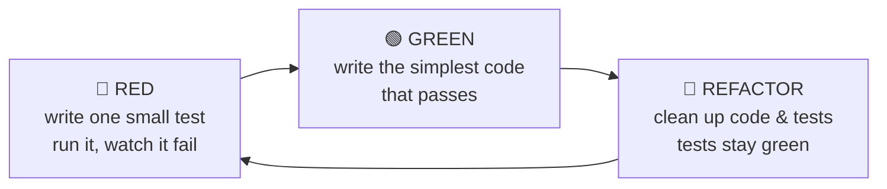

# LightNotes — Development Guide
*Your playbook for building LightNotes and the skills that come with it.*

- **What** to build: [[SRS|SRS]]
- **How** it is built: [[SDD|SDD]]
- **The order to build it in, and how to work professionally:** this guide

How to use it:
1. Read §1–§3 once.
2. Then work down the checklist in §4, ticking boxes as you go.
3. When you meet a concept you don't know yet, read its explanation in §3 *then*, not up front.

---

# 1. Ground rules
1. **`main` always works.** Every change goes through a branch and a pull request, and is merged only when CI is green.
2. **Small steps.** A good branch is a few hours to a couple of days of work. If a change feels huge, split it.
3. **Tests first for logic.** Everything in `domain/` and `app/` is written test-first (§3.3).
4. **Write down decisions.** Anything you'd have to explain to a teammate becomes an ADR (§3.8).
5. **Keep a dev log.** Note each problem, what you tried and what worked (§3.9). Future you will thank you.
6. **Minimal AI, used well:**
   - ✅ Ask AI to *explain* an error or concept, *review* a diff you wrote, or suggest *test cases* you missed.
   - ❌ Don't ask it to write the feature. If you're stuck for more than ~45 min, ask for a *hint*, not the code.
   - Turn off inline autocomplete (Copilot etc.) in this project, so the code is genuinely yours.
7. **Read the official docs first.** They are better than most tutorials.

# 2. One-time setup
## 2.1 Your machine
- **Git** with your name and email set (`git config --global user.name …`).
- **Node.js 24 LTS**, and use `npm`.
- **Rust** via `rustup`.
- **Tauri prerequisites** for your OS. Tauri's "Prerequisites" page has the list:
  - Linux: WebKitGTK and build tools.
  - Windows: Microsoft C++ Build Tools and WebView2.
- **VS Code** with these extensions: Svelte, ESLint, Prettier, rust-analyzer, Vitest.

## 2.2 Where things live
- **The code repo goes outside the vault,** e.g. `~/dev/lightnotes`. A `node_modules` folder inside Obsidian would slow it to a crawl.
- **Move the SRS, SDD and this guide into the repo's `docs/` folder** once it exists, so docs and code change together in the same pull requests. Open `docs/` as a second Obsidian vault if you want to keep editing them in Obsidian.

# 3. Concepts and practices

## 3.1 Git workflow (GitHub Flow)
```text
main ──●────────●───────────●──────────▶   always works, protected
        \      /             \
         ●──●─●  feat/countdown-format     one branch per todo item
```
The loop for every todo item:
```bash
git switch main && git pull                     # start from the latest main
git switch -c feat/countdown-format             # new branch
# … red → green → refactor, commit often …
git add -p                                      # review each change as you stage it
git commit -m "feat(domain): format countdown as days/hours (FR-P4)"
git push -u origin feat/countdown-format
gh pr create --fill                             # or open the PR on github.com
# read your own diff on GitHub, wait for CI to go green, then "Squash and merge"
```

**Branch names:** `feat/…`, `fix/…`, `test/…`, `docs/…`, `chore/…`, `refactor/…`.

**Commit messages** follow [Conventional Commits](https://www.conventionalcommits.org): `type(scope): summary`.
- Types: `feat`, `fix`, `test`, `refactor`, `docs`, `chore`, `ci`, `perf`.
- Put the requirement ID in the message when there is one. Your history then doubles as a changelog.

**Reviewing your own pull request:** on GitHub, read the "Files changed" tab as if a stranger wrote it. Self-review checklist:
- [ ] Does it do only what the branch name says?
- [ ] Are there tests, and did I see them fail before they passed?
- [ ] Are names clear without comments?
- [ ] No leftover `console.log`, commented-out code or TODOs without an issue?
- [ ] Do docs or an ADR need updating?

## 3.2 Issues and a project board
- Every unchecked item in §4 becomes a **GitHub Issue**, labelled `phase-0`, `phase-1` etc. (or `feature`, `bug`, `spike`).
- Put the issues on a **GitHub Projects** board with columns *Todo → In progress → Done*.
- Link the issue in the PR description (`Closes #12`), and GitHub closes it when the PR merges.

## 3.3 Test-driven development (TDD)
**What it is:** you write a small failing test *before* the code that makes it pass. The cycle is:



**Why it helps you:**
- It forces you to decide what the code should do before how.
- It gives you a safety net, so refactoring is fearless.
- The tests become a readable specification that stays true. Each SRS requirement turns into a handful of test cases.

**Worked example: `formatCountdown` (FR-P4)**

*Step 1 — RED.* Create `src/domain/countdown.test.ts`:
```ts
import { describe, it, expect } from 'vitest';
import { formatCountdown } from './countdown';

const MINUTE = 60_000, HOUR = 60 * MINUTE, DAY = 24 * HOUR;

describe('formatCountdown (FR-P4)', () => {
  it('shows days and hours when more than a day is left', () => {
    expect(formatCountdown(12 * DAY + 4 * HOUR + 5 * MINUTE)).toBe('12d 4h');
  });
});
```
Run `npx vitest`. It fails because `countdown.ts` doesn't exist. **Seeing it fail proves the test can fail**, which is the point of this step.

*Step 2 — GREEN.* Write the least code that passes:
```ts
const HOUR = 3_600_000, DAY = 24 * HOUR;

export function formatCountdown(msLeft: number): string {
  const days = Math.floor(msLeft / DAY);
  const hours = Math.floor((msLeft % DAY) / HOUR);
  return `${days}d ${hours}h`;
}
```

*Step 3 — REFACTOR.* Nothing to clean yet. Move on to the next test.

**Your turn.** Add these tests one at a time, each through red → green → refactor:
1. Under a day shows `hh:mm:ss`: `2 h 14 min 5 s` → `02:14:05`.
2. Exactly one day: decide the expected output, write it down as a test, then make it pass.
3. Past due shows `overdue 2h`.
4. Seconds round **up** while counting down, so `0.4 s` left shows `00:00:01`, not `00:00:00`. Why does that matter to a user?

**Rules of thumb:**
- **Test behaviour, not implementation.** Assert on outputs, not on which helper was called.
- **Name tests as sentences** that a non-programmer could read: *"a late completion keeps the streak"*.
- **Never read the real clock in domain code.** Pass `now` in (SDD §1.4), then a test can be any moment: `const now = Date.UTC(2026, 2, 29, 0, 30)` (the night the clocks change in Europe).
- **Use fakes, not mocks, for use cases.** An `InMemoryTaskRepository` that keeps rows in a `Map` is clearer than mocking every call.
- **One reason to fail per test.** Several `expect`s are fine if they check one behaviour.
- **Where TDD doesn't fit:** spikes (throwaway code), visual layout, and exploring an unfamiliar library. Test those afterwards or by hand.

**The test pyramid:** many fast unit tests, fewer integration tests, very few slow end-to-end tests. See SDD §12 for what goes where.

## 3.4 Code quality tools
| Tool | What it does | Command |
|---|---|---|
| **TypeScript** in `strict` mode | Catches type errors | `npm run check` (`svelte-check`) |
| **ESLint** | Catches bug-prone patterns and enforces the layer dependency rule (SDD §2) | `npm run lint` |
| **Prettier** | Formats code automatically; ends style debates | `npm run format` |
| **Vitest** | Unit and integration tests, coverage | `npm test` |
| **Playwright** | End-to-end tests in a real browser | `npm run e2e` |
| **rustfmt / clippy** | Rust formatting and linting | `cargo fmt`, `cargo clippy` |

The `package.json` scripts to set up:
```json
{
  "scripts": {
    "dev": "vite",
    "build": "vite build",
    "check": "svelte-check --tsconfig ./tsconfig.json",
    "lint": "eslint .",
    "format": "prettier --write .",
    "test": "vitest run",
    "test:watch": "vitest",
    "coverage": "vitest run --coverage",
    "e2e": "playwright test",
    "tauri": "tauri"
  }
}
```
**Optional:** a pre-commit hook (`lefthook` or `husky` + `lint-staged`) that runs Prettier and ESLint on staged files, so problems are caught before CI.

## 3.5 Continuous Integration (CI)
**What it is:** every time you push, a fresh machine on GitHub checks out your code and runs the checks (lint, types, tests, build). Problems surface within minutes and on a clean machine, never "it worked on my laptop".

**How:** GitHub Actions runs *workflows*, which are YAML files in `.github/workflows/`. Start with this `ci.yml`:
```yaml
name: CI
on:
  push:
    branches: [main]
  pull_request:

jobs:
  web:
    runs-on: ubuntu-latest
    steps:
      - uses: actions/checkout@v4
      - uses: actions/setup-node@v4
        with:
          node-version: 24
          cache: npm
      - run: npm ci
      - run: npm run lint
      - run: npm run check
      - run: npm run coverage
      - run: npm run build

  rust:
    runs-on: ubuntu-latest
    steps:
      - uses: actions/checkout@v4
      - name: Install Tauri system dependencies
        run: |
          sudo apt-get update
          sudo apt-get install -y libwebkit2gtk-4.1-dev build-essential libxdo-dev \
            libssl-dev libayatana-appindicator3-dev librsvg2-dev
      - uses: actions/setup-node@v4
        with:
          node-version: 24
          cache: npm
      - run: npm ci && npm run build      # Tauri needs the built frontend to compile
      - uses: dtolnay/rust-toolchain@stable
        with:
          components: clippy, rustfmt
      - uses: Swatinem/rust-cache@v2
        with:
          workspaces: src-tauri
      - run: cargo fmt --check
        working-directory: src-tauri
      - run: cargo clippy -- -D warnings
        working-directory: src-tauri
      - run: cargo test
        working-directory: src-tauri
```
Add an `e2e` job running Playwright once you have end-to-end tests (Milestone 1.7).

**Branch protection:** in GitHub, go to *Settings → Branches → Add rule for `main`*. Require a pull request and require the `web` and `rust` checks to pass. GitHub then *won't let you* merge broken code, even you.

## 3.6 Continuous Delivery (CD)
**What it is:** once CI is green, releasing is automated too. You push a version tag, and GitHub builds the installers and attaches them to a release.

**Versioning:** [Semantic Versioning](https://semver.org), `MAJOR.MINOR.PATCH`. Stay on `0.x.y` until it's stable for you; `0.1.0` is the end of Phase 1.

`release.yml`:
```yaml
name: Release
on:
  push:
    tags: ['v*']

jobs:
  build:
    permissions:
      contents: write
    strategy:
      fail-fast: false
      matrix:
        platform: [ubuntu-22.04, windows-latest]
    runs-on: ${{ matrix.platform }}
    steps:
      - uses: actions/checkout@v4
      - if: matrix.platform == 'ubuntu-22.04'
        run: |
          sudo apt-get update
          sudo apt-get install -y libwebkit2gtk-4.1-dev build-essential libxdo-dev \
            libssl-dev libayatana-appindicator3-dev librsvg2-dev
      - uses: actions/setup-node@v4
        with:
          node-version: 24
          cache: npm
      - uses: dtolnay/rust-toolchain@stable
      - run: npm ci
      - uses: tauri-apps/tauri-action@v0
        env:
          GITHUB_TOKEN: ${{ secrets.GITHUB_TOKEN }}
        with:
          tagName: ${{ github.ref_name }}
          releaseName: 'LightNotes ${{ github.ref_name }}'
          releaseDraft: true
```
To release:
```bash
npm version minor          # bumps package.json and creates the tag
git push --follow-tags
```
Then check the draft release on GitHub and publish it.

**Web build (Phase 1b):** add a job that deploys `npm run build` output to GitHub Pages or Cloudflare Pages on every merge to `main`.

## 3.7 Project hygiene files
- `README.md`: what it is, a screenshot, how to run it, how to test it.
- `CHANGELOG.md`: can be generated from conventional commits.
- `LICENSE`: e.g. MIT, if you make the repo public.
- `.editorconfig`, `.gitignore`, `.nvmrc` (pins the Node version).

## 3.8 Architecture Decision Records (ADRs)
**What:** a one-page note per significant decision, kept forever in `docs/adr/NNNN-title.md`. When you later wonder "why SQLite in the browser?", the answer is there, including what you rejected.

Template:
```markdown
# 0003 — SQLite everywhere, including WASM in the browser
Status: Accepted · Date: 2026-11-10

## Context
What problem, what constraints (link SRS requirements).

## Options considered
1. … pros / cons
2. … pros / cons

## Decision
What we chose and the main reason.

## Consequences
What gets easier, what gets harder, what we must watch.
```
Write ADRs 1–7 from SDD §16 during Phase 0, after the spikes, because the spikes are your evidence.

## 3.9 Dev log
One file per week in `docs/devlog/2026-W45.md`:
```markdown
## Tue 10 Nov
- Goal: occurrence materialisation
- Stuck: DST test failed — 19:00 became 20:00 on 29 Mar
- Cause: added 24 h instead of "next day at 19:00 local"
- Fix / lesson: never add 24 h for "tomorrow"; use calendar arithmetic
```

## 3.10 Debugging habits
1. **Reproduce** the bug first, ideally as a failing test (then it can never come back).
2. **Read the whole error message** and the stack trace.
3. **Form a hypothesis**, then check it (debugger breakpoints > `console.log`).
4. **Change one thing at a time.**
5. **Write down the cause** in the dev log.

# 4. Roadmap checklist
Each milestone ends in something you can run. **Done when** is the test of completion. Requirement IDs show what you're covering.

## Phase 0 — Foundations (≈ 2–3 weeks)
**Learn (only as much as needed):**
- [ ] TypeScript Handbook: *The Basics*, *Everyday Types*, *Narrowing*, *Object Types*
- [ ] The official Svelte tutorial (svelte.dev/tutorial), through runes, events and bindings
- [ ] *Pro Git* chapters 1–3 (free online)
- [ ] SQL basics: SELECT, JOIN, INDEX, transactions (e.g. SQLBolt)
- [ ] The Rust Book chapters 1–6 (just enough for `alarms.rs`)
- [ ] Tauri v2 docs: *Create a Project*, *Calling Rust from the Frontend*

**Set up the repo:**
- [ ] Create the GitHub repo `lightnotes`; scaffold with `npm create tauri-app@latest` (TypeScript, Svelte)
- [ ] Add ESLint, Prettier, Vitest, `svelte-check`, TypeScript `strict`; add the scripts from §3.4
- [ ] Add `ci.yml` (§3.5); open a PR and watch it go green
- [ ] Turn on branch protection for `main`
- [ ] Move SRS / SDD / guide into `docs/`; add README, `.editorconfig`, `.nvmrc`
- [ ] Create the issues and project board (§3.2)

**Spikes** (throwaway, on `spike/*` branches, never merged; SDD §15):
- [ ] S1 tray + timed notification on Linux
- [ ] S2 CodeMirror: hide `**` on non-cursor lines
- [ ] S3 SQLite-WASM + OPFS in the browser
- [ ] S5 Temporal polyfill in the Tauri web view
- [ ] Write ADRs 1–7

**Done when:** an empty Tauri + Svelte app runs, CI is green, `main` is protected, and the ADRs are written.

## Phase 1 — MVP on Linux desktop (≈ 2–4 months)

### 1.1 Domain core (TDD, no UI at all)
- [ ] `time.ts` helpers + `countdown.ts` (FR-P4), using the worked example in §3.3
- [ ] `urgency.ts` (FR-T8, FR-P5)
- [ ] `recurrence.ts`: next due time for daily / weekly / every N days, **including DST tests** (FR-T4)
- [ ] `occurrences.ts`: `materialise` and `occurrenceState` (FR-T5–T7)
- [ ] `completion.ts`: grace, late, backdating validation (FR-T10, FR-T11)
- [ ] `streaks.ts`: current/longest streak with the late-keeps-streak rule (FR-T12)
- [ ] `sessions.ts`: remaining, pause, resume (FR-D4)
- [ ] `tags.ts`, `log.ts` (FR-N3, FR-L2)
- [ ] ESLint rule enforcing that `domain/` imports nothing outside itself

**Done when:** `domain/` has ≥ 95 % coverage and you can explain every test name to someone.

### 1.2 Storage
- [ ] `Db` interface + `better-sqlite3` (or `node:sqlite`) adapter for tests
- [ ] Migration runner + `001_init.sql` (SDD §5.2–5.3); test that migrations build the schema
- [ ] Repositories for tasks, occurrences, notes, folders, sessions, with tests against real SQLite
- [ ] `tauri-sqlite` adapter; app opens the database on start

**Done when:** you can create a task in a test, restart, and read it back via the Tauri adapter.

### 1.3 Use cases
- [ ] Port interfaces + in-memory fakes
- [ ] `createTask`, `refreshOccurrences`, `startOccurrence`, `completeOccurrence`, `dismissOccurrence`
- [ ] `addLogEntry`, `startSession` / `pauseSession` / `finishSession`
- [ ] `saveNote`, `searchNotes`; composition root in `main.ts`

**Done when:** every use case has tests with fakes and a fixed clock.

### 1.4 Timers page (first usable version 🎉)
- [ ] `now.svelte.ts` single tick (SDD §7.3)
- [ ] `Ring.svelte` + `TaskCard.svelte` with countdown, urgency colour, quick actions (FR-P1–P6)
- [ ] Task create/edit dialog incl. recurrence, grace, session length (FR-T1–T4, FR-D1)
- [ ] Missed badge + list (complete late / dismiss), history strip (FR-T6, FR-T7)
- [ ] Backdated "done at…" picker (FR-T11)
- [ ] Group by Short / Long / Continuous, filter by status
- [ ] Session countdown on the card (FR-D1–D5)

**Done when:** you use it yourself for a full week of real tasks. Write down what annoys you.

### 1.5 Notes
- [ ] Notes page: folder tree (FR-N7), note list, CodeMirror with markdown highlighting
- [ ] Autosave: debounce + flush (FR-N2), with a test that a closed window loses nothing
- [ ] Tags: chips, filter by tag (FR-N3); search with FTS5 (FR-N5)
- [ ] Recent-notes sidebar on the Timers page (FR-P8); cards open their log note (FR-P7)
- [ ] "Add log entry" button + shortcut (FR-L2)
- [ ] Live preview v1, then v2 (SDD §7.4, FR-N1)
- [ ] Paste/drop images and files (FR-N4)

**Done when:** you write your daily notes in LightNotes instead of Obsidian for a week.

### 1.6 Reminders and background
- [ ] `computeAlarms` use case + tests
- [ ] Rust `alarms.rs` scheduler + `set_alarms` command, with `cargo test` for its logic
- [ ] Tray icon; close-to-tray; Quit in the tray menu; autostart setting (FR-T9, FR-D3)
- [ ] Sleep/wake handling
- [ ] Manual test checklist in `docs/manual-tests.md`

### 1.7 Polish and release v0.1.0
- [ ] Export all (FR-N6, NFR-4)
- [ ] Settings page: thresholds, default grace, theme (FR-T8, NFR-7)
- [ ] Keyboard navigation pass (NFR-7)
- [ ] Performance checks against SDD §13 (NFR-1)
- [ ] Playwright e2e for the two critical flows; add the `e2e` CI job
- [ ] `release.yml` (§3.6); tag `v0.1.0`; install the AppImage/.deb on your machine

**Done when:** you installed it from your own GitHub Release and use it daily.

## Phase 1b — Browser (≈ 2–4 weeks)
- [ ] `wasm-sqlite` adapter (OPFS); run the repository test suite against it
- [ ] Browser file storage for attachments (OPFS)
- [ ] Platform detection in `main.ts`
- [ ] In-tab notifications (SDD §8.3)
- [ ] Deploy to GitHub Pages / Cloudflare Pages from CI
- [ ] Release `v0.2.0`

## Phase 2 — Stats, accounts, sync
- [ ] Stats page (FR-S1–S7), with all stats as pure domain functions, TDD
- [ ] ADR 8 (sync model) and ADR 9 (auth and hosting); update SDD §9
- [ ] Spike: two browser tabs editing one note through Yjs
- [ ] Sync server, auth, guest → account merge (FR-A1–A6)
- [ ] Web Push reminders for the browser
- [ ] Security review against NFR-6

## Phase 3 — Android, Pomodoro, more platforms
- [ ] Spike S4 (Android exact notifications)
- [ ] Android build via Tauri mobile; touch-friendly layout
- [ ] Pomodoro (FR-F1–F2), built on sessions
- [ ] Windows installer in the release matrix (already in `release.yml`); iOS last

# 5. Resources
| Topic | Where |
|---|---|
| TypeScript | typescriptlang.org/docs/handbook |
| Svelte 5 | svelte.dev/tutorial and svelte.dev/docs |
| Tauri v2 | v2.tauri.app (guides, plugins: sql, notification, autostart, log) |
| CodeMirror 6 | codemirror.net: *System Guide*, *Examples* (especially "Decorations") |
| SQLite | sqlite.org/docs.html: FTS5, WAL, `PRAGMA user_version` |
| Testing | vitest.dev, playwright.dev, *Test Driven Development: By Example* (Kent Beck) |
| Git | *Pro Git* (git-scm.com/book) |
| GitHub Actions | docs.github.com/actions |
| Architecture | *Clean Architecture* (Robert C. Martin) for the dependency rule; Michael Nygard's original ADR article |
| Local-first & CRDTs (Phase 2) | Ink & Switch, *Local-first software* essay; docs.yjs.dev |
